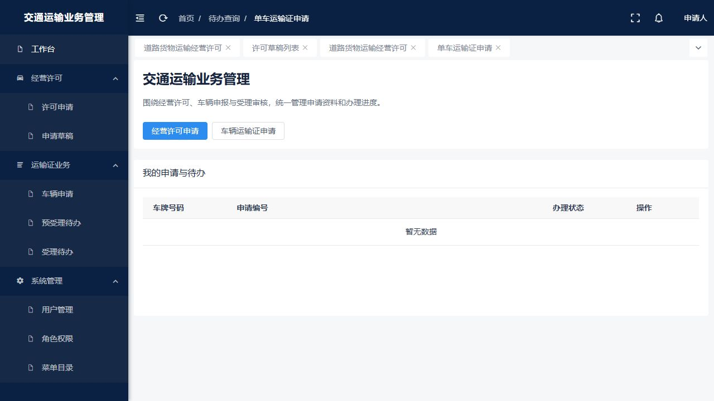

# 交通运输业务管理系统

面向运输业务申报与审核的全栈项目，在既有工程和教师提供的业务参考基础上完善业务流程与模块集成。



## 功能

- 道路货运经营许可：资料填写、草稿保存、查询、恢复、修改及提交。
- 单车运输证：车辆申报、预受理、人工审核受理、退回与重新提交。
- 系统管理：用户和角色创建、用户角色绑定、角色菜单权限维护、菜单目录查看。
- 数据校验：申请归属、状态流转、事务回滚与重复受理检查。

## 技术栈

Vue 3 · View UI Plus · Vue Router · Vuex · Java 8 · Spring Boot 2.5.3 · Spring Data JPA · Maven。业务环境面向 Oracle；本地演示使用独立的内存数据库。

## 运行

需要 Node/npm、JDK 8、Maven，以及原工程 `domed-common` 等私有依赖；私有依赖和商用组件二进制不随仓库分发。

```powershell
cd limit_space_vue
npm ci
cd ..
.\local-development\build-local-test.ps1 -MavenRepository '<已有依赖仓库路径>'
node .\local-development\start-local-test.cjs
```

打开 `http://127.0.0.1:18091/#/local/home`，通过右上角「体验身份」切换申请、预审、受理和管理视角。停止时按 Ctrl+C，或运行 `.\local-development\stop-local-test.ps1`。

演示仅监听本机；原认证与业务校验仍保留。审核操作不调用真实签发、检验或审批服务，许可提交不等于行政审批完成。本地数据随服务停止清空，真实业务环境的运行尚未验证。

## 来源与授权

前端沿用 Admin Plus 基础框架，保留其原始许可证；业务参考由教师提供。本仓库不将上游代码声明为独立原创，来源见 [NOTICE](NOTICE.md)。
